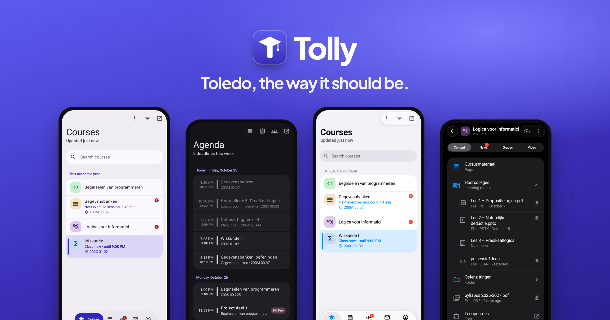

<div align="center">
  
  <h1>Tolly</h1>

A fast Android app for KU Leuven's Toledo.

[](https://github.com/Bueezi/tolly/releases/latest)
[](https://github.com/Bueezi/tolly/actions/workflows/ci.yml)
[](LICENSE)


**[tolly.be](https://tolly.be)**

</div>



> [!NOTE]
> Tolly is an unofficial, independent project. It is not made, endorsed or supported by KU Leuven.

## Features

- 📚 **Courses**: this year's courses with a subject icon and colour, your own order and names, and
  which one you have class in right now (until when, in which room)
- 📁 **Content**: folders, learning modules, pages, files and links; tests and assignments open
  in-app without a second sign-in
- 📣 **Announcements**: per course or all together, unread filter, swipe to mark read or flag, and
  optional notifications
- 📅 **Agenda**: Toledo's deadlines and events together with your KU Leuven timetable
- 🎓 **Grades** per course and for all courses at once, with feedback
- 🎬 **Video**: course recordings in a built-in player
- ⬇️ **Downloads**: background downloads, a whole course for offline use, and automatic copies in
  `Downloads/Tolly/<course>`
- 📴 **Offline**: everything you've seen stays available without a connection
- 🎨 **Two looks**: Material 3 Expressive with dynamic colour, or a Liquid Glass look after iOS 26;
  both in light and dark
- 📱 **Phones, foldables and tablets**: list-detail panes that resize and fold
- 🌍 **English and Dutch**: follows your phone's language, or pick one in Settings
- 🔒 **Private**: sign in on KU Leuven's own login page (MFA included). Tolly never sees your
  password, and has no ads, analytics or servers of its own

## Download

Get the APK from [GitHub Releases](https://github.com/Bueezi/tolly/releases/latest). Google Play
is coming.

## How it's made

Built with Claude by a student.

## Feedback

Bug reports and ideas are very welcome as [issues](https://github.com/Bueezi/tolly/issues), or
from the app under *You → Send feedback*. Because the code is AI-written, I'm not looking for code
contributions; an issue that describes the problem helps most.

## Building

You need JDK 21 and the Android SDK (Platform 37, Build-Tools 37.0.0). Then, in `android/`:

```bash
./gradlew assembleDebug
```

To look around without a KU Leuven account, install the debug build and start the demo with
`adb shell am start -n be.tolly.debug/be.tolly.DemoActivity`.

## Star history

<a href="https://star-history.com/#Bueezi/tolly&Date">
  <picture>
    <source media="(prefers-color-scheme: dark)" srcset="https://api.star-history.com/svg?repos=Bueezi/tolly&type=Date&theme=dark" />
    
  </picture>
</a>

## License

[AGPL-3.0-or-later](LICENSE). Toledo and KU Leuven are names of KU Leuven, used here only to say
what Tolly works with.
